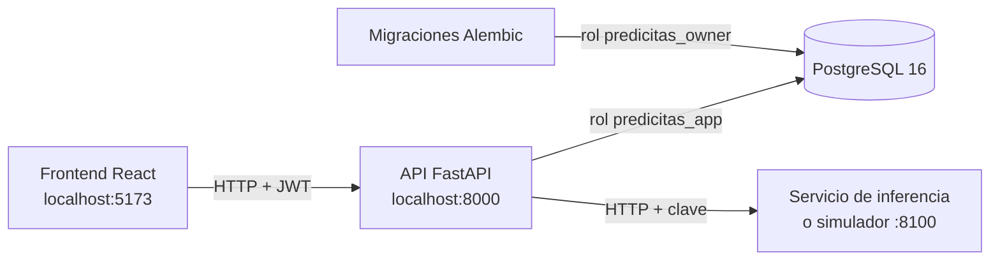

# PrediCitas CRP · Backend


API REST del **MVP PrediCitas CRP**: gestión predictiva de citas médicas **posterior al agendamiento** para la Clínica Ricardo Palma, Sede San Isidro (Cardiología, Traumatología y Pediatría).

> **Proyecto académico.** Universidad Privada del Norte (UPN), ciclo 2026-2, curso *Administración de Proyectos de Software*, Grupo 05.
> **Todos los datos son sintéticos y seudonimizados** (`paciente_anon_id`). El sistema no contiene ni debe recibir datos personales reales (Ley N.° 29733).

**Interfaz web:** [F1ld/frontend-predicitas](https://github.com/F1ld/frontend-predicitas)

---

## Contenido

1. [Qué resuelve](#1-qué-resuelve)
2. [Estado del desarrollo](#2-estado-del-desarrollo)
3. [Arquitectura y tecnologías](#3-arquitectura-y-tecnologías)
4. [Requisitos previos](#4-requisitos-previos)
5. [Inicio rápido con Docker](#5-inicio-rápido-con-docker)
6. [Desarrollo sin Docker](#6-desarrollo-sin-docker)
7. [Variables de entorno](#7-variables-de-entorno)
8. [Pruebas y cobertura](#8-pruebas-y-cobertura)
9. [Estructura del proyecto](#9-estructura-del-proyecto)
10. [Referencia de la API](#10-referencia-de-la-api)
11. [Convenciones](#11-convenciones)
12. [Seguridad y privacidad](#12-seguridad-y-privacidad)
13. [Flujo de trabajo y contribución](#13-flujo-de-trabajo-y-contribución)
14. [Glosario](#14-glosario)
15. [Equipo](#15-equipo)

---

## 1. Qué resuelve

Las citas ya existen: llegan desde el sistema de agendamiento de la clínica (por importación CSV o por registro manual). PrediCitas acompaña lo que pasa **después**:

1. **Seguimiento de la cita:** estados trazables (RECIBIDA → CONFIRMADA / REPROGRAMADA / CANCELADA / LIBERADA → ATENDIDA o NO_SHOW), con historial y check-in del día.
2. **Riesgo de inasistencia (no-show):** un servicio de inferencia calcula la probabilidad y el nivel de riesgo (BAJO, MEDIO o ALTO) de cada cita. El resultado orienta, **nunca es una decisión clínica**, y se rotula como simulado mientras se use el simulador.
3. **Intervención controlada:** a las citas de riesgo ALTO o MEDIO se les envía, de forma simulada, un recordatorio por WhatsApp, SMS o llamada, con consentimiento confirmado. Hay un máximo de un mensaje por cita (más un reintento si falla) y se respeta el opt-out.
4. **Liberación voluntaria del cupo:** si el paciente pide liberar su cita, el cupo queda disponible para la lista de espera, en una sola transacción.
5. **Trazabilidad:** cada acción relevante se registra en una bitácora de auditoría de solo inserción.

Lo usan tres roles: **Recepción**, **Administrador** y **Técnico IA**.

## 2. Estado del desarrollo

| Módulo | Alcance | Estado |
|---|---|---|
| M00 · Base | FastAPI, Docker, migraciones, formato de error único, cabeceras de seguridad, exportación | ✅ Certificado por QA |
| M01 · Autenticación y usuarios | Login con JWT, bloqueo por intentos fallidos, renovación e invalidación de sesión, gestión de usuarios | ✅ Certificado por QA |
| M02 · Recepción y seguimiento de citas | Bandeja con filtros, registro manual, importación CSV, transiciones de estado, check-in | ✅ Certificado por QA |
| M05 · Intervención inteligente + REP-02 | Elegibles, intervención con consentimiento, opt-out, límite, liberación de cupo, modo sombra y reporte REP-02 | ✅ Certificado por QA |
| M09 · Integración con IA | Cliente del servicio de inferencia, predicción individual y por lote, trazabilidad del modelo | 🔨 Implementado; QA pendiente |
| M06 · Lista de espera y reasignación | Candidatos, ofertas de cupo y reasignación con confirmación humana | 🔨 En desarrollo |
| M07 · Panel operativo · M08 · Auditoría | Panel de Recepción, reportes y consulta de auditoría | 📐 Planificado |

## 3. Arquitectura y tecnologías



| Capa | Tecnología |
|---|---|
| Lenguaje | Python 3.12 |
| API | FastAPI 0.143 · Pydantic 2 · Uvicorn |
| Persistencia | SQLAlchemy 2.1 · Alembic · PostgreSQL 16 (psycopg 3) |
| Seguridad | JWT (PyJWT) · Argon2 para contraseñas |
| Exportación | JSON, CSV (UTF-8 con BOM) y Excel (openpyxl) |
| Pruebas | pytest · pytest-cov (umbral 75 %) |
| Entorno | Docker y Docker Compose |

La base de datos tiene **9 tablas**: `usuarios`, `citas`, `historial_estados_cita`, `predicciones_ia`, `intervenciones`, `lista_espera`, `cupos_liberados`, `reasignaciones` y `auditoria_eventos`.

## 4. Requisitos previos

- **Con Docker (recomendado):** [Docker Desktop](https://www.docker.com/products/docker-desktop/) con Docker Compose v2. No necesitas Python ni PostgreSQL instalados.
- **Sin Docker:** Python 3.12 y PostgreSQL 16.
- Git, y opcionalmente el [frontend](https://github.com/F1ld/frontend-predicitas) para usar la interfaz.

## 5. Inicio rápido con Docker

```bash
git clone https://github.com/F1ld/backend-predicitas.git
cd backend-predicitas
docker compose up --build -d
```

Compose levanta tres servicios:

| Servicio | Qué hace |
|---|---|
| `db` | PostgreSQL 16, expuesto en `localhost:5433`. Al crear el volumen ejecuta `db/init/`, que crea el rol `predicitas_app`. |
| `migraciones` | Corre una vez `alembic upgrade head` con el rol dueño del esquema y termina. |
| `api` | Arranca cuando las migraciones terminaron bien. Se conecta con el rol de permisos mínimos `predicitas_app`. |

Con eso ya tienes:

- **Swagger (documentación interactiva):** http://localhost:8000/docs
- **Salud:** http://localhost:8000/health → `{"estado": "ok"}`

**Cargar datos de demostración** (360 citas sintéticas y 3 usuarios demo). El script pide una contraseña de al menos 8 caracteres para los tres usuarios:

```bash
docker compose run --rm api python -m scripts.seed
```

| Usuario demo | Rol |
|---|---|
| `admin@predicitas.crp` | ADMINISTRADOR |
| `recepcion@predicitas.crp` | RECEPCION |
| `tecnico.ia@predicitas.crp` | TECNICO_IA |

**Comandos útiles:**

```bash
docker compose logs -f api                               # registros de la API
docker compose run --rm api pytest                       # pruebas con cobertura
docker compose run --rm migraciones alembic current      # revisión de esquema aplicada
docker compose down                                      # detiene los servicios
docker compose down -v                                   # además borra la base (empezar de cero)
```

> El script de `db/init/` solo corre cuando el volumen de PostgreSQL está vacío. Si cambias `APP_DB_PASSWORD`, ejecuta `docker compose down -v`.

**Predicciones de riesgo:** la API llama al servicio de inferencia configurado en `IA_URL` (por defecto, `http://host.docker.internal:8100`, es decir, el puerto 8100 de tu equipo). Si el servicio no está disponible, la predicción responde `503 MOTOR_IA_NO_DISPONIBLE` y no se modifica ninguna cita; el resto de la API funciona con normalidad.

## 6. Desarrollo sin Docker

```bash
python -m venv .venv
.venv\Scripts\activate              # Windows · en Linux/macOS: source .venv/bin/activate
pip install -r requirements.txt
cp .env.example .env                 # ajusta DATABASE_URL y DATABASE_URL_MIGRACIONES
python -m scripts.crear_rol_app      # crea el rol predicitas_app (una vez)
alembic upgrade head
uvicorn app.main:app --reload        # http://localhost:8000/docs
```

Los detalles de roles, permisos y respaldo de la base están en [`db/README.md`](db/README.md).

## 7. Variables de entorno

Todas se leen en `app/core/config.py` y están documentadas en [`.env.example`](.env.example). **Los valores de ejemplo son solo para desarrollo local.**

| Variable | Para qué sirve | Ejemplo |
|---|---|---|
| `DATABASE_URL` | Conexión de la API con el rol `predicitas_app` | `postgresql+psycopg://predicitas_app:…@localhost:5432/predicitas` |
| `DATABASE_URL_MIGRACIONES` | Conexión del rol dueño, para Alembic y scripts | `postgresql+psycopg://predicitas_owner:…@localhost:5432/predicitas` |
| `SECRET_KEY` | Firma de los JWT (en un ambiente real, una cadena aleatoria larga) | — |
| `ACCESS_TOKEN_EXPIRE_MINUTES` | Duración de la sesión | `30` |
| `LOGIN_MAX_INTENTOS` · `LOGIN_VENTANA_MINUTOS` · `LOGIN_BLOQUEO_MINUTOS` | Bloqueo por intentos fallidos | `5` · `15` · `15` |
| `IA_URL` · `IA_API_KEY` · `IA_TIMEOUT_SEGUNDOS` | Servicio de inferencia | `http://localhost:8100` · — · `5` |
| `IA_CORTE_MEDIO` | Probabilidad a partir de la cual el riesgo deja de ser BAJO | `0.30` |
| `INTERVENCION_MODO_SOMBRA` | `true` = las intervenciones se calculan, pero no se crean ni se envían | `false` |
| `CORS_ORIGENES` | Orígenes del frontend permitidos, separados por comas | `http://localhost:5173` |

Con Docker Compose también puedes definir `POSTGRES_PASSWORD`, `APP_DB_PASSWORD` y `DB_PUERTO_HOST` en un `.env` junto a `docker-compose.yml`.

## 8. Pruebas y cobertura

```bash
pytest                               # con .venv, dentro de esta carpeta
docker compose run --rm api pytest   # con Docker
```

- `pytest.ini` activa la cobertura de `app/` y **falla si baja de 75 %**. La suite actual supera el 98 %.
- Las pruebas usan la base de `DATABASE_URL` y **deshacen sus cambios** al terminar: no ensucian los datos.
- Hay una carpeta por módulo (`tests/auth/`, `tests/citas/`, `tests/intervenciones/`…). Además, `tests/bd/` prueba los permisos del rol de la aplicación, y `tests/sistema/` la salud, el formato de error, las cabeceras y la exportación.
- Las pruebas citan los requisitos que comprueban (`RF-0XX`, `RNF-0XX`, `RN0X`) para mantener la trazabilidad con el SRS.

## 9. Estructura del proyecto

```text
.
├── app/
│   ├── main.py                  # crea la aplicación y registra los módulos
│   ├── core/                    # configuración, base de datos, seguridad, errores, cabeceras HTTP, exportación
│   └── modules/
│       ├── auth/                # login, sesión, renovación y cambio de clave
│       ├── usuarios/            # gestión de usuarios (Administrador)
│       ├── citas/               # bandeja, registro, importación CSV, estados y check-in
│       ├── intervenciones/      # intervención inteligente y reporte REP-02
│       ├── ia/                  # cliente del servicio de inferencia y predicciones
│       ├── lista_espera/        # lista de espera y cupos liberados
│       └── auditoria/           # bitácora de eventos
├── migrations/                  # Alembic: esquema de 9 tablas, rol operativo e índices
├── db/                          # script de inicio de PostgreSQL y guía de la base
├── scripts/                     # seed sintético, creación del rol y utilidades
├── data/                        # CSV de citas sintéticas de ejemplo
├── tests/                       # pruebas pytest por módulo
├── Dockerfile
├── docker-compose.yml
├── requirements.txt
├── alembic.ini
└── pytest.ini
```

Cada módulo sigue la misma forma: `router.py` (endpoints), `schemas.py` (entrada y salida), `service.py` (reglas de negocio), `repository.py` (consultas) y `models.py` (tablas).

## 10. Referencia de la API

La referencia completa y ejecutable está en **http://localhost:8000/docs**. Resumen de los endpoints disponibles:

| Módulo | Método y ruta | Qué hace |
|---|---|---|
| Autenticación | `POST /auth/login` | Inicia sesión (formulario `username` + `password`) y devuelve el token |
| | `GET /auth/me` | Datos del usuario de la sesión |
| | `POST /auth/renovar` · `POST /auth/logout` | Renueva o cierra la sesión |
| | `POST /auth/cambiar-clave` | Cambia la contraseña propia |
| Usuarios | `GET /usuarios` · `POST /usuarios` | Lista y crea usuarios |
| | `GET /usuarios/{id}` · `PATCH /usuarios/{id}` | Consulta y edita un usuario |
| | `POST /usuarios/{id}/estado` · `POST /usuarios/{id}/restablecer-acceso` | Activa o desactiva, y genera una clave temporal |
| Citas | `GET /citas` · `POST /citas` | Bandeja con filtros y paginación; registro manual |
| | `GET /citas/catalogos` | Catálogos para los filtros: especialidades, médicos, estados, niveles de riesgo, canales y tipos de paciente |
| | `POST /citas/importar` | Importación CSV con validación fila por fila |
| | `GET /citas/{id}` | Detalle con historial |
| | `POST /citas/{id}/estado` · `POST /citas/{id}/check-in` | Cambio de estado y registro de llegada |
| IA | `POST /citas/{id}/prediccion` · `POST /predicciones/lote` | Calcula el riesgo de una cita o de un rango de fechas |
| | `GET /predicciones` · `GET /predicciones/modelo` | Historial de predicciones y modelo activo |
| Intervenciones | `GET /intervenciones/elegibles` · `GET /intervenciones/plantillas` | Citas elegibles (ALTO/MEDIO) y plantillas por canal |
| | `POST /intervenciones` · `GET /intervenciones` · `GET /intervenciones/{id}` | Crea, lista y consulta intervenciones |
| | `POST /intervenciones/{id}/estado` · `POST /intervenciones/{id}/respuesta` | Registra el envío y la respuesta del paciente |
| | `POST /intervenciones/{id}/optout` · `POST /intervenciones/{id}/liberar-cupo` | Opt-out y liberación voluntaria del cupo |
| Reportes | `GET /reportes/rep-02?formato=json\|csv\|xlsx` | Efectividad de las intervenciones |

Los permisos se validan en el servidor según el rol:
- **Recepción y Administrador** operan citas e intervenciones.
- **Técnico IA** consulta citas e intervenciones, calcula predicciones y revisa su historial.
- La **gestión de usuarios** es exclusiva del Administrador.

Una acción sin permiso responde `403`.

## 11. Convenciones

- **Formato de error único.** Toda respuesta de error tiene esta forma, con un código estable que el frontend usa sin leer el mensaje:
  ```json
  { "error": { "codigo": "TRANSICION_INVALIDA", "mensaje": "…", "campos": {} } }
  ```
  En el código se lanzan las excepciones de `app/core/errores.py`.
- **Módulos que se registran solos.** Cada `app/modules/<modulo>/router.py` que exporta `router` se incluye automáticamente (`app/core/ranuras.py`). Agregar un módulo no requiere tocar `main.py`.
- **Nombres en español.** Los nombres de tablas, campos, rutas y enums siguen el diccionario de datos y el Diseño de Base de Datos oficial del proyecto.
- **Fechas y zona horaria.** Formato ISO 8601; la zona de negocio es `America/Lima`.
- **Transacciones.** Las operaciones críticas (por ejemplo, liberar un cupo: cita, cupo, historial y auditoría) se confirman juntas o no se confirman.
- **Booleanos estrictos.** Los campos que exigen `true` literal (como `consentimiento_confirmado`) no aceptan `1`, `"true"` ni `"yes"`.

## 12. Seguridad y privacidad

- Contraseñas con **Argon2**; sesiones JWT que expiran y quedan invalidadas al cerrar sesión o al cambiar el usuario.
- **Bloqueo** configurable tras varios intentos fallidos de login.
- **Mínimo privilegio en la base:** la API usa `predicitas_app`, sin `UPDATE` ni `DELETE` sobre `auditoria_eventos` e `historial_estados_cita`. Además, unos triggers impiden modificar esas bitácoras incluso al dueño del esquema.
- Cabeceras `Content-Security-Policy`, `X-Content-Type-Options`, `Referrer-Policy` y `X-Frame-Options`.
- **Sin secretos en el repositorio:** el `.env` está ignorado por git, y los valores de `.env.example` son solo de desarrollo. En un ambiente desplegado la API va detrás de HTTPS.
- Solo datos **sintéticos y seudonimizados**; los registros no contienen datos personales, contraseñas ni tokens.

## 13. Flujo de trabajo y contribución

- **Ramas:** `main` contiene las versiones estables; el trabajo se integra desde ramas de trabajo como `Project-Manager`, por *pull request*.
- **Commits:** [Conventional Commits](https://www.conventionalcommits.org/es/) en español, con el requisito que implementan. Por ejemplo: `feat(citas): registro manual de cita (RF-010)`.
- **Antes de abrir un PR:** `pytest` en verde con cobertura ≥ 75 %, sin secretos ni datos reales, y con los requisitos citados en el código y en las pruebas.

## 14. Glosario

| Término | Significado |
|---|---|
| **No-show** | El paciente no asiste a su cita y no avisa. |
| **Riesgo** | Probabilidad de no-show calculada por el servicio de inferencia, agrupada en BAJO, MEDIO o ALTO. |
| **Intervención** | Recordatorio simulado (WhatsApp, SMS o llamada) a una cita de riesgo ALTO o MEDIO. |
| **Opt-out** | El paciente pide no recibir más mensajes: ninguna de sus citas admite nuevas intervenciones. |
| **Cupo liberado** | Horario que queda libre cuando el paciente libera su cita; alimenta la lista de espera. |
| **Modo sombra** | Configuración en la que el sistema calcula, pero no crea ni envía intervenciones. |
| **Resultado simulado** | Rótulo obligatorio mientras el riesgo venga del simulador y no de un modelo validado. |
| **`paciente_anon_id`** | Identificador seudonimizado del paciente; reemplaza cualquier dato personal. |

## 15. Equipo

Grupo 05 · UPN 2026-2

| Rol | Integrante |
|---|---|
| Director del proyecto | Nicolas Goray |
| Programador y tester | Anders Ramirez |
| Datos e IA | Deivi Ferrer |
| Calidad | Jose Gutierrez |

---

<sub>Proyecto académico con fines educativos. Cliente de referencia: Clínica Ricardo Palma, Sede San Isidro. Ningún dato de este repositorio corresponde a pacientes reales.</sub>
